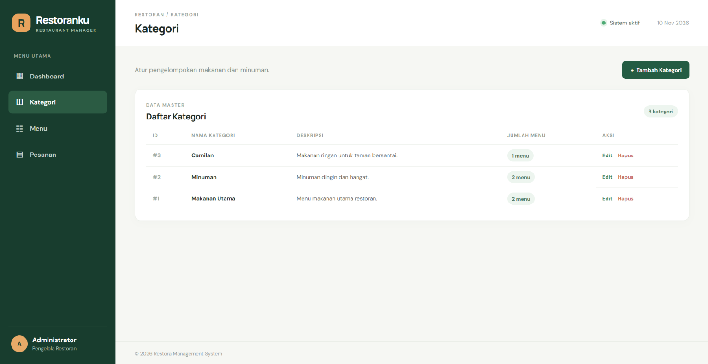

## Janji

Saya Raffi Akbar Ardiansyah dengan NIM 2511604 mengerjakan Tugas Praktikum 7 dalam mata kuliah Desain dan Pemrograman Berorientasi Objek untuk keberkahan-Nya maka saya tidak melakukan kecurangan seperti yang telah dispesifikasikan. Aamiin.

## 1. Deskripsi Tema Website

Aplikasi ini merupakan **Sistem Manajemen Restoran (Restaurant Management System)**, yaitu aplikasi berbasis website yang dirancang untuk membantu pengelolaan operasional restoran. Sistem ini menyediakan pengelolaan data kategori makanan dan minuman, daftar menu restoran, serta pencatatan pesanan pelanggan.

Aplikasi ini memiliki tiga entitas utama, yaitu Kategori, Menu, dan Pesanan. Administrator dapat melakukan pengelolaan data melalui fitur CRUD (Create, Read, Update, Delete) pada setiap entitas.

Pengembangan aplikasi ini menerapkan paradigma **Object-Oriented Programming (OOP)** menggunakan PHP Native, koneksi database menggunakan PDO (PHP Data Objects), serta Prepared Statements untuk seluruh operasi database guna meningkatkan keamanan dari SQL Injection.

## 2. Struktur Database & Relasi Tabel

Sistem menggunakan database MySQL bernama `db_restoran` yang terdiri dari tiga entitas (tabel) yang saling berhubungan.

### A. Tabel `kategori` (Master Data Kategori)

Menyimpan informasi kategori makanan dan minuman yang tersedia di restoran.

- `id_kategori` (INT, Primary Key, Auto Increment): ID unik setiap kategori.
- `nama_kategori` (VARCHAR): Nama kategori makanan atau minuman.
- `deskripsi` (TEXT): Penjelasan mengenai kategori.

### B. Tabel `menu` (Master Data Menu)

Menyimpan informasi seluruh makanan dan minuman yang dijual oleh restoran.

- `id_menu` (INT, Primary Key, Auto Increment): ID unik setiap menu.
- `id_kategori` (INT, Foreign Key): Mengacu pada `kategori(id_kategori)`.
- `nama_menu` (VARCHAR): Nama makanan atau minuman.
- `jenis_menu` (VARCHAR): Jenis menu, seperti makanan atau minuman.
- `harga` (DECIMAL): Harga jual menu.
- `stok` (INT): Jumlah stok menu yang tersedia.
- `deskripsi` (TEXT): Penjelasan mengenai menu.

### C. Tabel `pesanan` (Tabel Transaksi Pesanan)

Menyimpan informasi transaksi pesanan pelanggan yang berhubungan dengan menu restoran.

- `id_pesanan` (INT, Primary Key, Auto Increment): ID unik setiap pesanan.
- `id_menu` (INT, Foreign Key): Mengacu pada `menu(id_menu)`.
- `nama_pelanggan` (VARCHAR): Nama pelanggan yang melakukan pemesanan.
- `jumlah` (INT): Jumlah menu yang dipesan.
- `total_harga` (DECIMAL): Total harga pesanan.
- `tanggal_pesanan` (DATETIME): Waktu pesanan dibuat.
- `status_pesanan` (VARCHAR): Status pesanan, seperti Diproses, Selesai, atau Dibatalkan.

### Relasi Antar Tabel

Sistem memiliki dua relasi utama:

1. **Kategori - Menu (One-to-Many):** Satu kategori dapat memiliki banyak menu, sedangkan satu menu hanya terhubung dengan satu kategori.
2. **Menu - Pesanan (One-to-Many):** Satu menu dapat muncul dalam banyak transaksi pesanan, sedangkan satu pesanan mengacu pada satu menu.

### Diagram Relasi Database

```text
+--------------------+
|      kategori      |
+--------------------+
| PK id_kategori     |
| nama_kategori      |
| deskripsi          |
+--------------------+
          |
          | 1
          |
          | N
+--------------------+
|        menu        |
+--------------------+
| PK id_menu         |
| FK id_kategori     |
| nama_menu          |
| jenis_menu         |
| harga              |
| stok               |
| deskripsi          |
+--------------------+
          |
          | 1
          |
          | N
+--------------------+
|      pesanan       |
+--------------------+
| PK id_pesanan      |
| FK id_menu         |
| nama_pelanggan     |
| jumlah             |
| total_harga        |
| tanggal_pesanan    |
| status_pesanan     |
+--------------------+
```

Seluruh tabel menggunakan storage engine **InnoDB** agar mendukung relasi Foreign Key dan integritas data.

## 3. Struktur Folder & Arsitektur Kode

Project disusun menggunakan struktur direktori yang terorganisasi untuk memisahkan tanggung jawab antara koneksi database, pengelolaan data, konfigurasi, dan tampilan website.

```text
TP7DPBO2526C1_Restoran/
│
├── class/
│   ├── Database.php       # Class pengelola koneksi PDO
│   ├── Kategori.php       # Class CRUD kategori
│   ├── Menu.php           # Class CRUD menu
│   └── Pesanan.php        # Class CRUD pesanan
│
├── config/
│   └── database.php       # Konfigurasi koneksi database
│
├── database/
│   └── db_restoran.sql    # Struktur dan data awal database
│
├── dokumentasi/           # Screenshot dokumentasi fitur aplikasi
│   ├── menu awal.png
│   ├── kategori.png
│   ├── daftar pesanan.png
│   ├── tambah Menu.png
│   ├── edit menu 1.png
│   ├── edit menu 2.png
│   ├── Delete 1.png
│   └── delete 2.png
│
├── view/
│   ├── header.php         # Komponen header dan navigasi
│   ├── footer.php         # Komponen footer
│   ├── kategori.php       # Tampilan data kategori
│   ├── menu.php           # Tampilan data menu
│   ├── pesanan.php        # Tampilan data pesanan
│   └── style.css          # Custom styling website
│
├── index.php              # Entry point dan router aplikasi
└── README.md              # Dokumentasi project
```

## 4. Penjelasan Penerapan OOP & Flow Program

### A. Database Layer (class/Database.php)

Class `Database` bertanggung jawab mengelola koneksi aplikasi dengan database MySQL menggunakan PDO (PHP Data Objects).

Koneksi database menggunakan konfigurasi yang terdapat pada `config/database.php`.

PDO dikonfigurasi menggunakan `PDO::ERRMODE_EXCEPTION` agar kesalahan ketika menjalankan query dapat ditangani melalui mekanisme exception.

### B. Business Logic & Data Access Layer (class/)

Folder `class/` berisi class yang bertanggung jawab mengelola setiap entitas database.

1. **Class Kategori:** Mengelola operasi CRUD pada tabel `kategori`, meliputi penambahan, pengambilan, perubahan, dan penghapusan data kategori.
2. **Class Menu:** Mengelola operasi CRUD pada tabel `menu`, termasuk pengelolaan kategori menu, jenis menu, harga, stok, dan deskripsi.
3. **Class Pesanan:** Mengelola operasi CRUD pada tabel `pesanan`, termasuk pencatatan pelanggan, jumlah pesanan, total harga, tanggal, dan status pesanan.

Setiap class memiliki tanggung jawab masing-masing sehingga pengelolaan data lebih terstruktur dan mudah dikembangkan.

### C. Keamanan Query Database (PDO & Prepared Statement)

Sesuai ketentuan Modul 8 - OOP dalam Website PHP, seluruh operasi database wajib menggunakan Prepared Statement.

Implementasi query menggunakan:

- `$pdo->prepare()` untuk mempersiapkan perintah SQL.
- `$stmt->execute()` untuk menjalankan query dengan parameter.
- PDO untuk mengelola komunikasi antara aplikasi PHP dan database.

Prepared Statement diterapkan pada seluruh operasi SELECT, INSERT, UPDATE, dan DELETE.

Aplikasi tidak menggunakan `mysqli_query()`, `$db->query()`, maupun `$pdo->query()` tanpa Prepared Statement.

Contoh penerapan:

```php
$stmt = $this->pdo->prepare(
    "SELECT * FROM kategori WHERE id_kategori = :id"
);

$stmt->execute([
    ':id' => $id
]);

$data = $stmt->fetch();
```

Dengan penerapan tersebut, input pengguna tidak digabungkan secara langsung ke dalam query SQL sehingga dapat membantu mencegah SQL Injection.

### D. Presentation & Routing Layer (view/ dan index.php)

**1. index.php (Main Router)**

File `index.php` merupakan titik awal aplikasi yang bertanggung jawab mengatur alur request dan response.

File ini mengatur navigasi halaman, menerima request dari pengguna, memanggil class yang sesuai, memproses operasi CRUD, dan menentukan view yang akan ditampilkan.

**2. view/ (Modular GUI)**

Folder `view/` berisi komponen tampilan website yang dipisahkan berdasarkan fungsinya.

- `header.php`: Menampilkan bagian atas website dan navigasi utama.
- `footer.php`: Menampilkan bagian bawah website.
- `kategori.php`: Menampilkan form dan tabel pengelolaan kategori.
- `menu.php`: Menampilkan form dan tabel pengelolaan menu.
- `pesanan.php`: Menampilkan form dan tabel pengelolaan pesanan.
- `style.css`: Mengatur tampilan visual website.

Pemisahan tersebut bertujuan agar kode HTML lebih terorganisasi dan tidak bercampur dengan proses pengelolaan database.

## 5. Fitur Website

### A. Dashboard

Dashboard merupakan halaman utama yang menampilkan ringkasan informasi restoran, seperti:

- Total kategori terdaftar.
- Total menu makanan dan minuman.
- Total pesanan yang tercatat.
- Total pendapatan pesanan.
- Informasi pesanan terbaru.
- Akses cepat menuju halaman pengelolaan data.

### B. Manajemen Kategori

Fitur untuk mengelola kategori makanan dan minuman.

- Menambahkan kategori baru.
- Menampilkan seluruh kategori.
- Mengubah informasi kategori.
- Menghapus kategori.

### C. Manajemen Menu

Fitur untuk mengelola daftar makanan dan minuman restoran.

- Menambahkan menu baru.
- Memilih kategori menu.
- Mengatur jenis menu.
- Mengatur harga dan stok.
- Menampilkan seluruh menu.
- Mengubah informasi menu.
- Menghapus menu.

### D. Manajemen Pesanan

Fitur untuk mengelola transaksi pemesanan pelanggan.

- Menambahkan pesanan pelanggan.
- Memilih menu yang dipesan.
- Mengisi jumlah pesanan.
- Menghitung total harga.
- Menampilkan daftar pesanan.
- Mengubah informasi pesanan.
- Mengubah status pesanan.
- Menghapus pesanan.

## 6. Dokumentasi Pengujian Fitur

Pengujian dilakukan untuk memastikan seluruh fungsi CRUD pada setiap tabel dapat berjalan dengan baik.

### A. Pengujian CRUD Kategori

**Create:** Menambahkan kategori makanan atau minuman baru.

**Read:** Menampilkan seluruh kategori yang tersimpan di database.

**Update:** Mengubah nama dan deskripsi kategori.

**Delete:** Menghapus kategori yang tidak digunakan oleh data menu.

### B. Pengujian CRUD Menu

**Create:** Menambahkan menu baru dengan memilih kategori yang tersedia.

**Read:** Menampilkan daftar menu beserta informasi kategorinya.

**Update:** Mengubah nama menu, jenis, harga, stok, dan deskripsi.

**Delete:** Menghapus data menu yang tidak digunakan oleh pesanan.

### C. Pengujian CRUD Pesanan

**Create:** Membuat pesanan baru dengan memilih menu dan mengisi data pelanggan.

**Read:** Menampilkan daftar pesanan pelanggan.

**Update:** Mengubah jumlah pesanan dan informasi status pesanan.

**Delete:** Menghapus data pesanan yang tidak diperlukan.

### D. Pengujian Relasi Database

Pengujian relasi dilakukan untuk memastikan Foreign Key bekerja sesuai ketentuan.

1. Memastikan menu hanya dapat menggunakan kategori yang tersedia.
2. Memastikan pesanan hanya dapat menggunakan menu yang tersedia.
3. Memastikan integritas data tetap terjaga ketika melakukan perubahan atau penghapusan data yang memiliki relasi.

### Dokumentasi Screenshot

Screenshot hasil pengujian fitur tersedia di folder [`dokumentasi/`](dokumentasi/).

**Halaman awal:**


**Manajemen kategori:**



**Daftar pesanan:**


**Tambah menu:**


**Edit menu:**


**Hapus data:**


